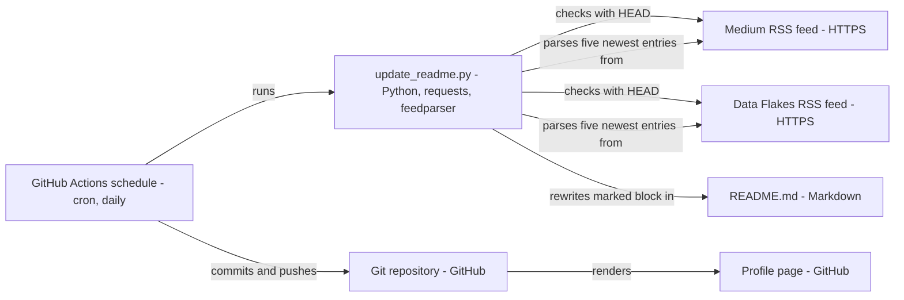

# ElliottFairhall profile repository - Architecture and design rationale

*Last updated: 2026-11-07 · commit 8a9bd36d4*

## 1. Purpose and scope

This is the GitHub profile repository: its `README.md` is shown on the owner's GitHub profile page. Most of it is
hand-written. One section, between the markers `<!-- BLOG-POST-LIST:START -->` and `<!-- BLOG-POST-LIST:END -->`, is
rewritten automatically with the latest posts from two RSS feeds by `update_readme.py`, run daily by a GitHub Actions
workflow. It is a small automation for a personal page, not a general feed aggregator.

## 2. How this project was built

This project was built with Claude Code (Anthropic's AI coding assistant) in a complementary role. Elliott Fairhall is
the author and owner: he wrote the script's first version (the header records the original redesign and later error
handling by him), and debugs, tests and uses the project for learning and development. The script header also records a
2026 refactor for Ruff standards by another AI tool. No automated tests are in the repository, and none are claimed.

## 3. Architecture at a glance

- The schedule triggers the script; the script reads two feeds and rewrites one block; the workflow commits the result.

## 4. Components

| Component       | Responsibility                                                     | Key files                             | Depends on               |
| --------------- | ------------------------------------------------------------------ | ------------------------------------- | ------------------------ |
| Profile content | Hand-written introduction, skills, links                           | `README.md`                           | None                     |
| Updater script  | Fetch two feeds, format five links each, replace the marked block  | `update_readme.py`                    | `requests`, `feedparser` |
| Workflow        | Schedule, manual run, install dependencies, run, commit if changed | `.github/workflows/update-readme.yml` | GitHub Actions, `git`    |

## 5. Data and control flow

**Inputs:** two feed URLs held as constants (a Medium author feed and the Data Flakes `rss.xml`), `MAX_POSTS = 5`, and
the marker comments in the README.

1. The workflow runs at 00:00 UTC daily, on manual dispatch, or on a push that touches `README.md`.
2. For each feed the script sends a HEAD request (10 second timeout, browser-style User-Agent). Only HTTP 200 counts as
   reachable.
3. Reachable feeds are parsed with `feedparser`; the five newest entries become `- [title](link)` lines.
4. If at least one feed returned posts, the script replaces everything between the markers, with a heading per feed, and
   writes the file only if the content changed.
5. The workflow commits `README.md` as the GitHub Actions bot if there is a diff and pushes.

**State** lives only in the README. **Failure behaviour:** every error is logged and swallowed; the script always exits
0\.

## 6. Design rationale

### Automate only the blog list, between marker comments

- **Why:** the profile is mostly static, and the one thing that goes stale is "latest posts". Markers let the script own
  one block and leave hand-written text alone, with a simple string replace rather than a Markdown parser.
- **Gave up:** missing or edited markers silently stop updates (the script logs an error and returns).
- **Alternative not taken:** a third-party profile-README action, or hand-editing. The script gives control over
  formatting and feeds, and is a small learning exercise in Python automation.
- **Evidence:** documented in the script header (purpose) and commits `372294b02`, `bc7867a74` (README path and marker
  fix) and `bbc1a873e`.

### Pre-check each feed, and skip what fails

- **Why:** a HEAD check gives a clear log line for network problems separate from parse problems, and one feed being
  down should not stop the other from updating.
- **Gave up:** a skipped feed removes its whole section from the README on the next write, because the block is rebuilt
  from whatever succeeded. Also, `requests.head` does not follow redirects by default, so a redirecting feed URL would
  count as unreachable (TODO: verify against the live URLs).
- **Alternative not taken:** keep the previous section when a feed fails, or fail the workflow so it is noticed.
- **Evidence:** documented in the header revision of 05-11-2024 (more error handling); the consequences are inferred
  from the code.

### Treat a feed parse warning as failure

- **Why:** `feed.bozo` flags malformed feeds, so partial or corrupt data is not written to the public profile.
- **Gave up:** a feed with a minor encoding quirk is rejected completely.
- **Alternative not taken:** accept entries when they exist despite the flag.
- **Evidence:** inferred from the code.

### Write only when the content changed

- **Why:** this avoids empty commits and a noisy contribution graph. The workflow's `git commit ... || exit 0` backs
  this up.
- **Gave up:** nothing material.
- **Alternative not taken:** always write and let Git detect no change.
- **Evidence:** documented in the code comment ("avoid unnecessary commits").

### Use the full `rss.xml` for Data Flakes

- **Why:** the header (02-03-2026) records a switch from `rss-featured.xml` to `rss.xml` so all posts appear, not just
  featured ones.
- **Gave up:** the list is no longer curated.
- **Alternative not taken:** the featured feed.
- **Evidence:** documented in the script header.

### GitHub Actions on a schedule, committing from the workflow

- **Why:** it is free for a public repository, needs no server, and uses the bot identity so history stays separate from
  hand edits. A daily run is frequent enough for a weekly blog.
- **Gave up:** no failure notification (the job succeeds even if no feed worked); no declared token permissions in the
  workflow (TODO: verify the repository default allows pushes). The workflow's name says "Medium Posts" although it
  covers both feeds. GitHub also pauses scheduled workflows in repositories with no recent activity, which would apply
  if the page went quiet.
- **Alternative not taken:** run on the owner's machine or a self-hosted runner (the monorepo history shows a runner was
  set up for other work), or a Pull Request flow for review.
- **Evidence:** the workflow file; the choice of schedule over alternatives is inferred.

### Plain dependencies installed at run time

- **Why:** two small libraries, so there is no lock file or packaging.
- **Gave up:** unpinned `pip install feedparser requests` can break on a new release.
- **Alternative not taken:** a pinned `requirements.txt`.
- **Evidence:** inferred from the workflow.

## 7. Quality and testing

No tests. The header of the script says tests are completed before continuing, which refers to the connection check at
run time, not a test suite. Ruff-style typing and Google-style docstrings are applied (header, 25-01-2026). Checks are
the workflow log and the README diff. A failure looks like a missing or stale blog section.

## 8. Constraints, limitations and known gaps

- Exit code is always 0, so a total failure is invisible in the Actions status.
- A single failing feed deletes that feed's section.
- Redirecting feed URLs may be reported unreachable (TODO: verify).
- The marker comments must stay in the README.
- Links come from the feed with query strings kept as given (Medium links include `?source=rss-...`).
- The README also embeds third-party stats images, whose availability is outside this repository.
- The profile text, including role and employer details, is hand-written and needs manual updating.

## 9. Running and extending

Run `python update_readme.py` locally with `feedparser` and `requests` installed; it edits `README.md` beside it. To add
a feed, add a URL constant, fetch it in `main()` and add a heading in `update_readme()`. Keep the markers in place. A
useful next step would be to exit non-zero when every feed fails.

## 10. Rationale (confirmed by the owner)

Confirmed by Elliott Fairhall on 2026-11-07. This reasoning was first reconstructed from the code and commit history;
the owner has since agreed it is correct, so it is now the stated rationale rather than an inference.

- Swallowing all errors (exit 0) was chosen to keep the profile page stable rather than to hide failures.
- Skipping a failed feed, which removes its section, was accepted rather than an oversight.
- Daily cron was chosen to match a roughly weekly publishing cadence.
- Rejecting any feed with a parse warning was intentional, to avoid publishing partial data.
